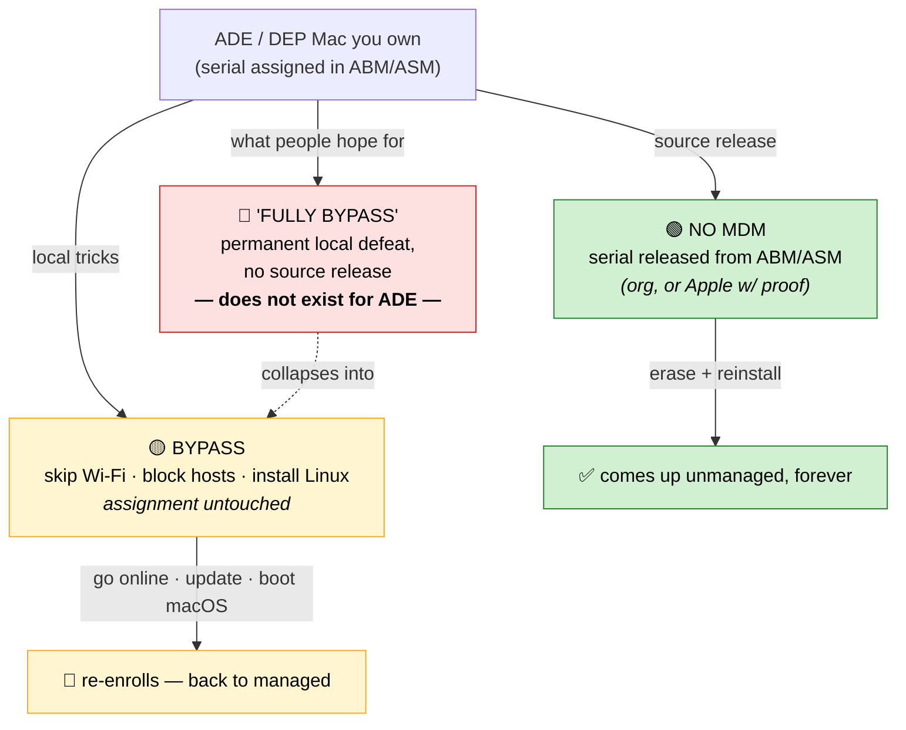

# Bypass vs. "fully bypass" vs. no MDM — what's the difference?

People use three phrases loosely, and the confusion is the whole problem. This
page pins down what each one actually means, side by side, so you can tell which
one you're really getting.

The one-line version:

- **Bypass** = management is still assigned; you just dodged the check. Temporary.
- **"Fully bypass"** = a *permanent local defeat without a source release*. For
  ADE/DEP this **does not exist** — it's the thing people wish were real.
- **No MDM** = the assignment itself is gone. Permanent. The only real endpoint.

---

## The three states defined

### 1. Bypass MDM  (temporary)

You get a usable, unmanaged-feeling desktop, but the **ABM/ASM assignment is
untouched**. You've only avoided or interrupted the check-in. Examples:

- "Continue without Internet" / skip Wi-Fi at Setup Assistant
- Blocking Apple/MDM hostnames in `/etc/hosts` or a firewall
- Deleting the local profile on an ADE device
- Installing Linux so macOS never boots to check in

It reverts the moment the condition breaks: you go online, the host-block is
removed, a macOS update re-scans, or you boot macOS again. You are re-bypassing
forever. (See [`why-reformat-doesnt-work.md`](why-reformat-doesnt-work.md) and
[`linux-does-not-remove-mdm.md`](linux-does-not-remove-mdm.md).)

### 2. "Fully bypass" MDM  (the myth, for ADE/DEP)

This is the phrase in your question, and it's where the trouble is. People mean:
*"a permanent bypass — defeated locally, once, and it never comes back, without
anyone releasing it at the source."*

**For an ADE/DEP device, this does not exist.** The assignment lives on Apple's
servers keyed to your serial (see [`how-mdm-works.md`](how-mdm-works.md)). No
local action — reformat, firmware poke, Linux, paid "bypass tool" — edits that
record. Anything sold to you as a permanent local bypass is either:

- actually just a **temporary bypass** (state 1) that will revert, or
- a **scam**.

The only way "it never comes back" is to remove the assignment itself — which is
state 3, and that's done at the source, not locally.

> ⚠️ The uncomfortable truth: for ADE/DEP, "fully bypass" and "no MDM" are not
> two options. The *only* permanent outcome is a source release. Everything
> else collapses back to "temporary bypass."

### 3. No MDM  (fully removed — permanent)

Management is genuinely, permanently gone. Reached two ways, depending on
enrollment type:

- **User/manual enrollment:** you removed the local profile. There was never a
  source record, so it's just *gone*. (This is the one case where a purely local
  action is also the complete removal.)
- **ADE/DEP enrollment:** the owning org pressed **Release Device** in ABM/ASM
  (or Apple did it with your proof of purchase). The serial is no longer
  assigned, so macOS reinstalls clean forever. (See
  [`escalation-playbook.md`](escalation-playbook.md).)

---

## Side-by-side

| | **Bypass** | **"Fully bypass"** (ADE/DEP) | **No MDM** (removed) |
|---|---|---|---|
| ABM/ASM assignment | still assigned | still assigned | **released / none** |
| Where the change is | on your disk / network | — (doesn't exist locally) | at the source (ABM/ASM) |
| Usable now? | yes | — | yes |
| Survives reboot? | sometimes | — | ✅ yes |
| Survives macOS reinstall? | ❌ no — re-enrolls | — | ✅ yes |
| Survives a macOS update? | often ❌ | — | ✅ yes |
| Who can do it | you, locally | nobody (for ADE) | the owning org, or Apple w/ proof |
| Effort to maintain | ongoing, forever | — | one time, then done |
| Honest label | *temporary workaround* | *myth / scam bait* | *actual removal* |

---

## How the states relate

---

## So which do you actually want?

- If the Mac is **user-enrolled** (`DEP: No`): removing the profile *is* "No MDM."
  Bypass vs. removal is a non-issue — just remove it.
- If the Mac is **ADE/DEP** (`DEP: Yes`) and **you own it**: skip the bypass
  rabbit hole. The only thing that ends the loop is a **source release**, so go
  straight to the [`escalation-playbook.md`](escalation-playbook.md).
- If the Mac is **an organization's**: none of this applies — ask IT. See
  [`legal-and-ethics.md`](legal-and-ethics.md).

Not sure which you have? Run `./scripts/mdm-status.sh` and read
[`identify-enrollment.md`](identify-enrollment.md).
