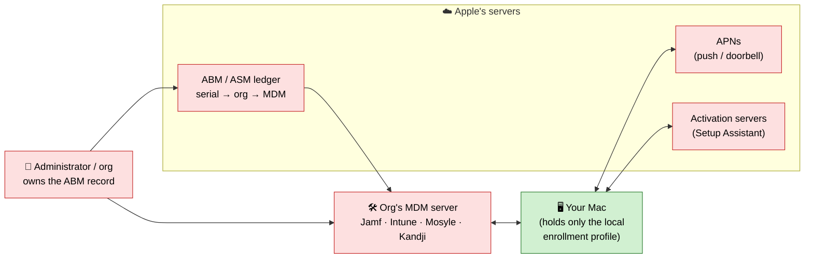
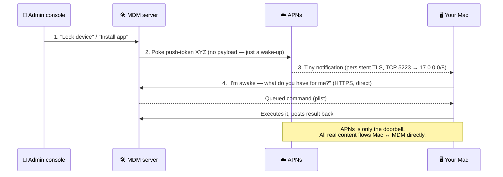
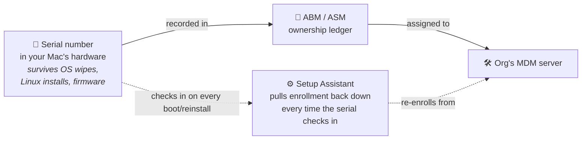

# How Apple MDM actually works

To remove MDM intelligently you have to know what it *is*. "MDM" feels like a
single lock on your Mac, but it's really a **relationship between four parties**,
and only one small piece of it lives on your disk. Once you see the pieces, it
becomes obvious which removal methods work, which are temporary, and why.

This doc is the mechanism. The removal docs
([`supported-removal.md`](supported-removal.md),
[`why-reformat-doesnt-work.md`](why-reformat-doesnt-work.md),
[`linux-does-not-remove-mdm.md`](linux-does-not-remove-mdm.md)) are just
consequences of what's below.

---

## 1. The four parties

> Green = the only part you control. Everything red is held by Apple or the
> organization — which is why wiping your disk (green) doesn't end the
> relationship.

1. **Your Mac** — holds a local *MDM enrollment profile* (a signed
   configuration file) and a device *identity certificate*.
2. **Apple's cloud** — three distinct services:
   - **APNs** (Apple Push Notification service): the "doorbell."
   - **Activation servers**: what a fresh macOS install talks to during Setup
     Assistant.
   - **ABM / ASM** (Apple Business/School Manager): the ownership ledger that
     maps **serial numbers → organizations → MDM servers**.
3. **The org's MDM server** — Jamf, Intune, Mosyle, Kandji, Apple's own Profile
   Manager, etc. This is what actually issues commands.
4. **The administrator** — a human/organization that owns the ABM record.

The crucial point: **the authority to manage your Mac is distributed across all
four.** Your disk holds only #1. That's why wiping the disk doesn't end the
relationship — the other three parties still agree your Mac belongs to the org.

---

## 2. The protocol: it's *pull-based*, not push

A common misconception is that the MDM server "reaches into" your Mac. It
can't. Apple's MDM protocol is **pull-based** and runs over plain HTTPS with
XML property-list (plist) messages. The server never opens a connection to your
device. The flow is:

So APNs is just a **doorbell**. All the real content — profiles, commands, app
installs, "erase device" — travels directly between your Mac and the MDM server
over an authenticated HTTPS channel. The device keeps a standing connection to
APNs so it can be woken at any time.

This design is why management feels "always on": your Mac is *listening*, and
the moment it has network it can be handed a command.

---

## 3. The two sub-protocols

Apple MDM is really two protocols stitched together:

| Sub-protocol | Job |
|--------------|-----|
| **Check-in protocol** | Enrollment and eligibility: "is this device allowed to be managed, and by whom?" Handles the initial handshake and the device identity certificate. |
| **Command protocol** | Day-to-day management: install/remove profiles and apps, query inventory, lock, wipe, set restrictions. This is the step-4 traffic above. |

When people talk about *removing* MDM, they almost always mean breaking the
**check-in** relationship — because that's what decides, every time the Mac
boots or reinstalls, whether the command channel gets re-established at all.

---

## 4. Two ways a Mac gets enrolled (this is everything)

The entire removal story hinges on **which** of these two paths enrolled your
Mac. Check it with `profiles status -type enrollment` (see
[`identify-enrollment.md`](identify-enrollment.md)).

### A. User / manual enrollment  (`Enrolled via DEP: No`)

Someone installed the MDM enrollment profile by hand — opening a `.mobileconfig`,
clicking a web enrollment link, etc. The authority to manage comes **from that
installed profile**. There is **no ABM record** asserting ownership of the
serial.

- The relationship is anchored **on your disk**.
- Remove the profile → the relationship is gone. Nothing re-creates it.
- This is designed to be user-removable (sometimes behind a removal passcode).

### B. Automated Device Enrollment — ADE / DEP  (`Enrolled via DEP: Yes`)

The serial number is registered in an organization's **ABM/ASM** account and
assigned to their MDM server. This is Apple's "zero-touch" deployment: buy
devices through Apple or an authorized reseller, and they show up in ABM
pre-assigned.

- The authority is anchored **in Apple's cloud ledger**, keyed to the serial.
- On first boot / after any macOS reinstall, Setup Assistant contacts Apple's
  **activation servers**. Apple looks up the serial, sees it belongs to the org,
  and hands the Mac to that org's MDM → the **Remote Management** screen.
- The on-disk profile is just a *copy* of a decision made in the cloud. Deleting
  the copy changes nothing about the decision.

**This is intentional.** ADE is also the anti-theft / fleet-ownership mechanism.
A device being managed "no matter what you install" is the *feature*, not a bug
you can out-engineer locally.

---

## 5. The identity certificate and APNs certificate

Two certificates matter:

- **Device identity certificate** — issued to your Mac during check-in; it's how
  the Mac proves to the MDM server it's the enrolled device. Lives in the
  System keychain, tied to the enrollment profile. Gone when the profile is
  properly removed.
- **APNs (push) certificate** — the MDM vendor's certificate (valid ~365 days)
  that lets the MDM server talk to APNs for that org. It's tied to the Apple
  Account that created it. This one is **the org's**, not yours — but it's worth
  knowing it exists, because if an org's APNs cert lapses, management silently
  stops working even though the enrollment still "exists." (That is a broken
  state, not removal — it comes back when they renew.)

---

## 6. Why each removal method does or doesn't work — derived from the above

Now the mechanism explains everything. Every method is really answering one
question: **does it break the check-in authority, or just interrupt the command
channel?**

| Method | What it touches | Result |
|--------|-----------------|--------|
| **Remove the local profile** (user enrollment) | The *only* anchor of authority (party #1) | ✅ **Real removal.** No ABM record exists to re-create it. |
| **Remove local profile / wipe** (ADE device) | A cloud-decided *copy* on disk | ❌ Temporary. Activation servers re-assign on next check-in. |
| **Erase & reinstall macOS** (ADE) | Disk only | ❌ Re-enrolls at Setup Assistant. |
| **Install Linux** | Disk only; macOS (the thing that checks in) never runs | ⚠️ Management goes **dormant**, not removed. Serial still assigned; returns if macOS runs. |
| **Block APNs / MDM hostnames** | Interrupts the *doorbell* (step 3) and command channel | ⚠️ Temporary & fragile. Authority intact; management resumes when unblocked or on another network. |
| **"Continue without Internet" at setup** | Avoids the activation check (step toward 4-party agreement) | ⚠️ Delays only; fires the moment the Mac is online. |
| **Release the serial from ABM/ASM** (at the source) | **The cloud ledger itself** (party #2's record of party #3's claim) | ✅ **Complete, permanent removal.** The 4-party agreement is dissolved. |

Read down that table and the pattern is stark: **everything local attacks the
command channel or a disk-side copy. Only the ABM/ASM release attacks the
authority.** That is the whole reason this repo keeps pointing at the source
release — it's not bureaucratic preference, it's the only operation that edits
the party that actually holds the claim.

---

## 7. So — *why can we remove MDM at all?*

Because removal is just **unwinding whichever anchor created the authority**, and
you can legitimately reach that anchor when you own the device:

1. **User-enrolled Macs** are removable **by you, locally**, because the
   authority is a profile sitting on your own disk. Deleting it dissolves the
   relationship outright — there is no higher authority re-asserting it. This is
   fully supported and reversible; Apple designed it to be user-removable.

2. **ADE/DEP Macs** are removable **at the source** because the authority is a
   record in ABM/ASM, and Apple's own rules let the owner reach it:
   - The organization that holds the record can press **Release Device** — a
     one-time, non-reversible action Apple provides specifically so hardware can
     change hands.
   - Organizations are **contractually obligated** under the ABM/ASM terms to
     release devices they no longer own.
   - If the org won't act, **Apple itself** will disassociate the serial for the
     rightful owner on **proof of purchase**.

   So even the "unbreakable" case is removable — not by defeating the mechanism,
   but by using the ownership-transfer path the mechanism was built to support.

In other words, MDM is removable precisely because it was designed around
**ownership**. When ownership is yours, every anchor of the management
relationship has a legitimate door:

- the on-disk profile → you delete it;
- the ABM/ASM record → the owner releases it (or Apple does, with proof).

What there *isn't* is a local trick that removes an ADE claim without touching
the ledger — and now you can see why: the claim was never on your Mac to begin
with.

---

### Sources

- [Fleet — What is Apple MDM?](https://fleetdm.com/articles/what-is-apple-mdm)
- [Appaloosa — APNs: the push service behind Apple MDM](https://www.appaloosa.io/blog/apple-push-notification-service-apns-mdm)
- [Apple — Automated Device Enrollment and device management](https://support.apple.com/guide/deployment/automated-device-enrollment-management-dep73069dd57/web)
- [Apple — Manage Setup Assistant for Apple devices](https://support.apple.com/en-gb/guide/deployment/depdeff4a547/web)
