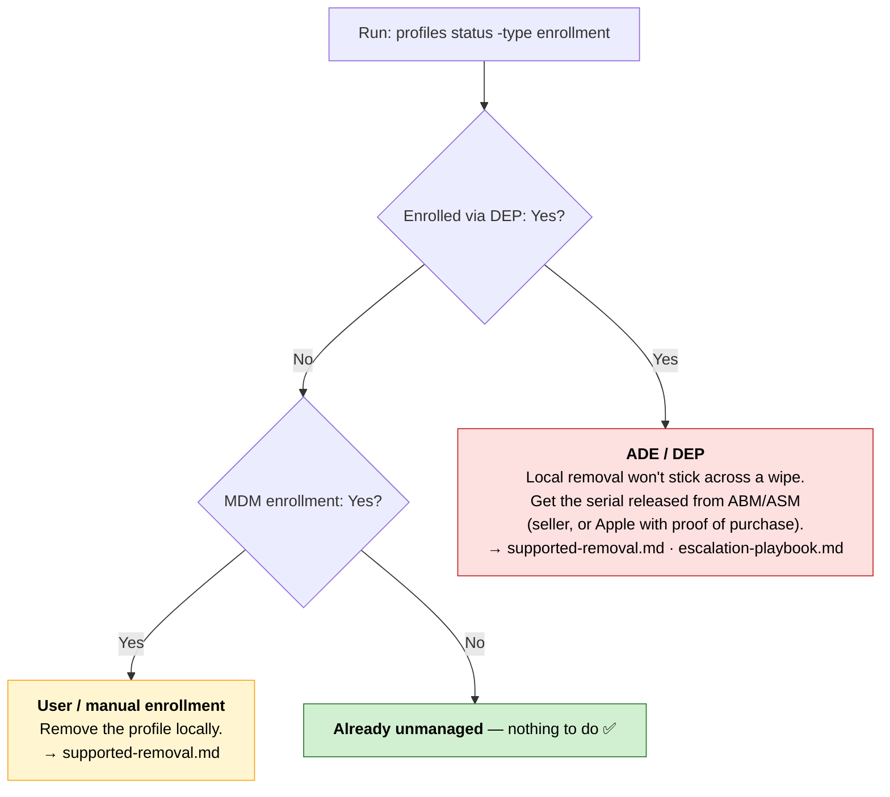

# Identifying your enrollment type

Before removing anything, find out **how** the Mac is enrolled. The removal
path depends entirely on this. All commands here are read-only.

## 1. Is there an MDM profile installed?

**System Settings → General → Device Management** (older macOS:
**System Preferences → Profiles**). If there's no "Device Management" pane at
all, the Mac is not currently managed by a local profile.

From the terminal:

```sh
# Lists installed configuration profiles (needs admin for full output)
sudo profiles list

# Shows enrollment + whether it came from DEP/ADE
profiles status -type enrollment
```

Interpreting `profiles status -type enrollment`:

| Output | Meaning |
|--------|---------|
| `Enrolled via DEP: No` + `MDM enrollment: No` | Not managed. Nothing to remove. |
| `Enrolled via DEP: No` + `MDM enrollment: Yes (User Approved)` | **Manual/user enrollment.** Removable locally — see supported-removal.md. |
| `Enrolled via DEP: Yes` | **Automated Device Enrollment (ADE/DEP).** Tied to an Apple Business/School Manager record. Must be released at the source. |

## 2. Is it supervised?

```sh
# "IsSupervised" appears in the enrollment profile details
sudo profiles show -type enrollment 2>/dev/null | grep -i supervis
```

Supervision almost always means ADE. Supervised + DEP = the device will
re-enroll after an erase unless the ABM/ASM record is removed.

## 3. Check Activation Lock / Find My context

```sh
# Shows Activation Lock status (relevant on Apple silicon / T2)
system_profiler SPHardwareDataType | grep -i "Activation Lock"
```

## 4. Note the serial number (you'll need it for the source removal)

```sh
system_profiler SPHardwareDataType | awk -F': ' '/Serial Number/{print $2}'
```

## Decision tree



Run [`../scripts/mdm-status.sh`](../scripts/mdm-status.sh) to collect all of
the above in one go.
