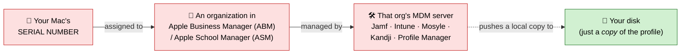

# Why reformatting doesn't remove MDM (and what "complete" removal means)

> "Someone said if we reformat the drive, we have to bypass again."

They're right — and understanding *why* is the whole point. For an
**Automated Device Enrollment (ADE / DEP)** Mac, reformatting can never be a
complete removal, because the enrollment doesn't live on the drive.

## Where the enrollment actually lives



> Red lives in Apple's cloud and the org — an erase can't touch it. Green (the
> local copy on your disk) is all a reformat removes.

The assignment is a record in **Apple's cloud**, tied to the hardware serial.
Your disk only holds a *local* MDM configuration profile that was handed down
from that server. Erasing the disk removes the local profile — not the cloud
assignment.

## The re-enrollment loop, step by step

1. You erase & reinstall macOS. The local MDM profile is gone. ✅
2. Setup Assistant runs and connects to the network.
3. macOS contacts **Apple's activation servers** and sends the serial number.
4. Apple sees the serial is **still assigned** to an org's MDM in ABM/ASM.
5. Apple hands the Mac back to that MDM → the **Remote Management** screen
   appears again, often mandatory. 🔁

Nothing you did locally changed step 4, so you're back where you started. A
major macOS upgrade can re-run this check too.

## Why the "bypass" tricks are temporary (not removal)

All of the popular tricks target **step 2–3 (the check)**, never **step 4 (the
assignment)**:

| Trick | What it really does | Why it doesn't last |
|-------|--------------------|---------------------|
| "Continue without Internet" / skip Wi-Fi during setup | Avoids reaching Apple's servers, so the check never fires | The moment the Mac goes online (or a later OS update), the check fires and management returns |
| Blocking MDM/Apple hostnames in `/etc/hosts` or a firewall | Stops the handoff network call | Fragile; breaks other Apple services; undone by a reinstall; management returns once unblocked |
| Deleting the local profile / terminal edits mid-setup | Removes the on-disk artifact | The cloud assignment is untouched; re-appears on next check |

These can get you to a usable desktop, but the serial is still owned by someone
else's MDM. That's not "fully removed" — it's "temporarily not checking in,"
and it is **working exactly as the anti-theft feature intends**. There is no
supported local change that outlives a server-side check.

## What "complete" removal requires

Exactly one action makes it permanent, and it happens **at the source, not on
your Mac**:

> **Release the device from ABM/ASM.**
> In Apple Business/School Manager: **Devices → search the serial number →
> Release Device.** This is one-time and non-reversible.

After the serial is released:

1. Erase & reinstall macOS.
2. At Setup Assistant, Apple no longer finds an assignment → **no Remote
   Management screen**, ever again. Fully unmanaged. ✅

### How you (the owner) get that to happen

You can't do the Release yourself unless you run the ABM/ASM org. So:

1. **Ask the seller / reseller** to release the serial. Organizations are
   contractually obligated under the ABM/ASM terms to release devices they no
   longer own. Give them the serial number.
2. **If they won't or can't**, go to **Apple** with **proof of purchase** and
   request removal of the device from Device Enrollment / ADE. Apple can
   disassociate the serial.
3. **Identify who holds it**: the local profile's `Server` key shows the
   enrollment URL, which hints at the managing org:
   ```sh
   sudo profiles show -type enrollment 2>/dev/null | grep -iA1 server
   ```

## The honest bottom line

- **User/manual enrollment (DEP: No):** reformatting *does* fully remove it —
  there's nothing server-side to come back. (See
  [`supported-removal.md`](supported-removal.md).)
- **ADE/DEP enrollment (DEP: Yes):** reformatting **never** fully removes it.
  The only complete, permanent removal is a **source release from ABM/ASM**.
  Anything else is a temporary bypass you'll keep redoing — by design.

Run [`../scripts/mdm-status.sh`](../scripts/mdm-status.sh) and check
`Enrolled via DEP:` to know which case you're in.

---

### Sources

- [Apple — Automated Device Enrollment and device management](https://support.apple.com/guide/deployment/automated-device-enrollment-management-dep73069dd57/web)
- [Apple — Manage Setup Assistant for Apple devices](https://support.apple.com/en-gb/guide/deployment/depdeff4a547/web)
- [Jamf community — No remote management prompt after clean OS install](https://community.jamf.com/t5/jamf-pro/no-remote-management-prompt-after-clean-os-install/td-p/227552)
- [Jamf community — Remove my laptop from Device Enrollment Program prompt](https://community.jamf.com/t5/jamf-pro/remove-my-laptop-from-device-enrollment-program-prompt/m-p/33296)
- [Apple Community — How to remove MDM from my MacBook Pro?](https://discussions.apple.com/thread/255406252)
